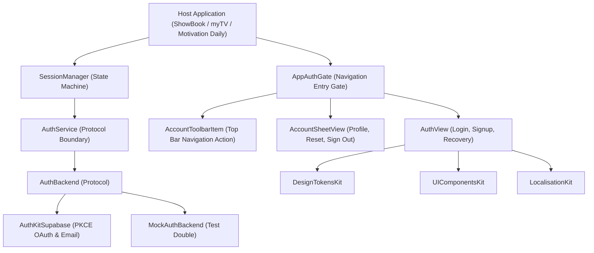
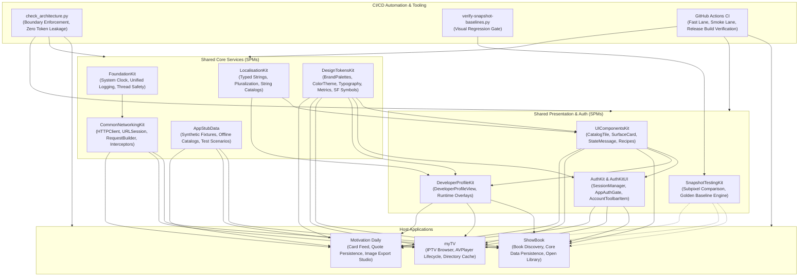

# AuthKit & AuthKitUI

A modular, secure authentication and session management architecture built with Swift 6 strict concurrency for multi-app ecosystems (**ShowBook**, **myTV**, and **Motivation Daily**).


---

## 1. Executive Summary & Purpose

`AuthKit` isolates backend authentication providers, user sessions, and security protocols into an independent module, while `AuthKitUI` provides customizable, accessible SwiftUI authentication flows and account management views.

### Key Engineering Objectives:
- **Provider Agnostic Core**: `AuthKit` defines the abstract `AuthBackend` protocol. The default `AuthKitSupabase` adapter implements PKCE browser OAuth and email/password authentication using Supabase.
- **Strict Concurrency State Management**: `SessionManager` is an `@Observable` / `@Published` actor-safe state machine managing session restoration, token renewal, and profile state.
- **Decoupled Account Entry (IOS-82)**: Account presentation is decoupled from intrusive bottom safe area overlays into a clean navigation toolbar item (`AccountToolbarItem`), preventing collision with host `TabView` structures.
- **Zero Token & Secret Logging**: Implements strict data privacy policies—tokens, passwords, recovery callbacks, and session secrets are completely redacted from diagnostic logging.

---

## 2. Architecture & Design Principles



### Supported Flows:
1. **Email & Password**: Registration, login, password reset requests, and callback handling.
2. **Federated OAuth**: Google, GitHub, and Apple via Supabase PKCE browser authorization.
3. **Session Lifecycle**: Background token refresh, app relaunch restoration, and local session termination.
4. **Account Management**: Profile viewing, password reset trigger, account sign-out, and account deletion confirmation with explicit accessibility identifiers.

---

## 3. Dependency Graph & Consumer Matrix

| Direction | Package / Project | Responsibility |
|---|---|---|
| **Upstream Dependencies** | **DesignTokensKit** (`v1.22.3`) | Brand palettes (`BrandPalette.showBook`, `myTV`, `motivationDaily`) and button geometry. |
| | **UIComponentsKit** (`v1.9.0`) | Reusable surfaces, text fields, banners, and buttons. |
| | **LocalisationKit** (`v0.8.1`) | Localized authentication labels, prompts, and error messages. |
| | **FoundationKit** (`v0.2.0`) | Structured logging abstractions. |
| **Downstream Consumers** | **ShowBook** | Secures book bookmark ownership, user preferences, and export features. |
| | **myTV** | Secures channel favorites across devices and user preferences. |
| | **Motivation Daily** | Secures favorite quotes, custom wallpaper collections, and share studio credits. |

---

## 4. API Contracts & Practical Code Examples

### 1. Initializing and Wiring `SessionManager` at Host Root
```swift
import SwiftUI
import AuthKit
import AuthKitSupabase
import AuthKitUI
import Supabase

@main
struct ShowBookApp: App {
    @StateObject private var session: SessionManager

    init() {
        let callbackURL = URL(string: "showbook-auth://auth/callback")!
        let client = SupabaseClient(
            supabaseURL: URL(string: "https://your-project.supabase.co")!,
            supabaseKey: "YOUR_ANON_KEY"
        )
        let backend = SupabaseAuthBackend(client: client, redirectURL: callbackURL)
        _session = StateObject(wrappedValue: SessionManager(backend: backend))
    }

    var body: some Scene {
        WindowGroup {
            AppAuthGate(
                session: session,
                brand: .showBook,
                content: {
                    ContentView()
                }
            )
            .task {
                await session.restoreSession()
            }
        }
    }
}
```

### 2. Using `AccountToolbarItem` in Feature Navigation (IOS-82)
```swift
import SwiftUI
import AuthKitUI

struct DashboardView: View {
    @ObservedObject var session: SessionManager

    var body: some View {
        NavigationStack {
            CatalogContentView()
                .navigationTitle("Discover")
                .toolbar {
                    AccountToolbarItem(session: session)
                }
        }
    }
}
```

---

## 5. Security & Privacy Safeguards

- **Keychain Storage**: Session tokens and refresh tokens are stored securely in the device Keychain using biometric flags where available.
- **Zero Raw Secret Logging**: Interceptors strictly strip Authorization headers and sensitive URL query strings before telemetry output.
- **OAuth Callback Validation**: Host applications must validate incoming URL schemes and paths against configured allowlists before delegating to `session.handleCallback(url)`.

---

## 6. Verification & Testing

```sh
# Run AuthKit unit tests (SessionManager state machine, tokens, MockBackend)
swift test

# Build AuthKitUI for iOS Simulator target
xcodebuild -scheme AuthKitUI -destination 'platform=iOS Simulator,name=iPhone 11' build
```

---

## 7. End-to-End Ecosystem Connectivity



---

## 8. Canonical Notion Dashboards & Governance Links

- [iOS Portfolio — Engineering Tickets Dashboard](https://app.notion.com/p/c20d7f4b133b44499c8ac0b4d5f6249e?pvs=204)
- [iOS Portfolio — Master Document](https://app.notion.com/p/40ffa5f855b98192ad2ede66a5d36fe7)
- [Architecture Boundary Validator (`check_architecture.py`)](file:///Users/anuragchourasia/Desktop/Projects/UIComponentsKit/Scripts/check_architecture.py)
- [Release & Gate Policy Documentation (`Docs/MASTER.md`)](file:///Users/anuragchourasia/Desktop/Projects/Docs/MASTER.md)
